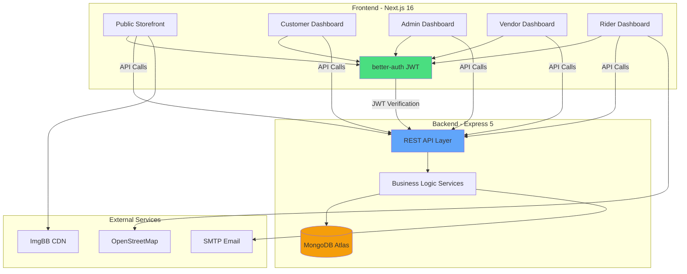
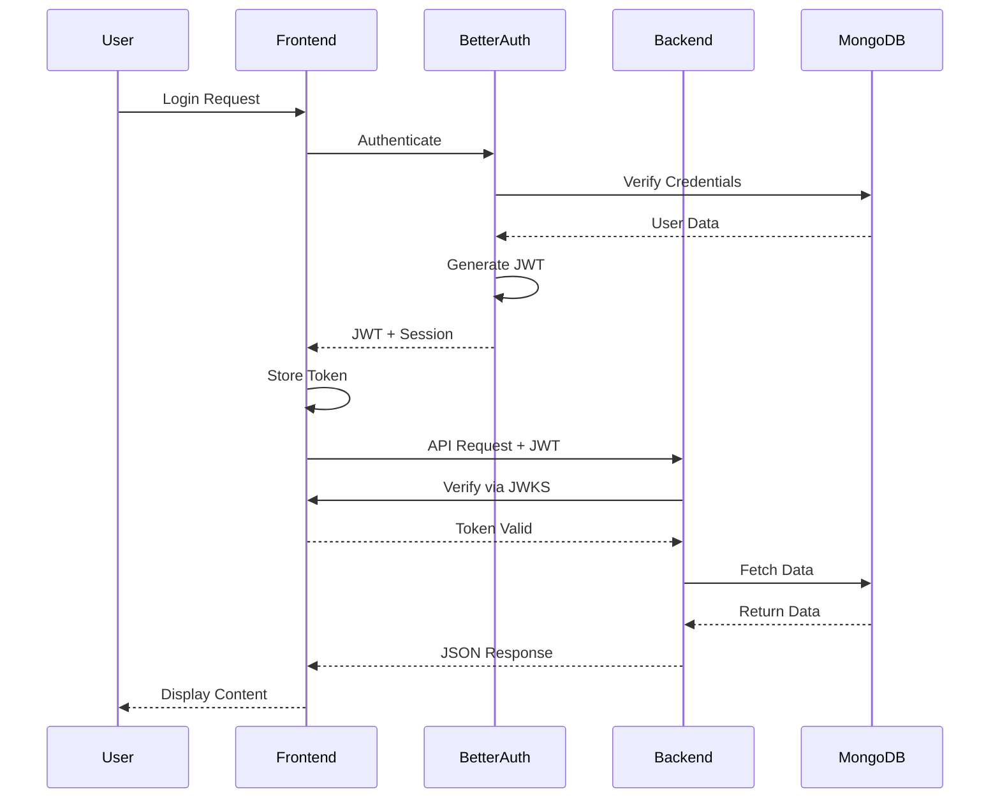
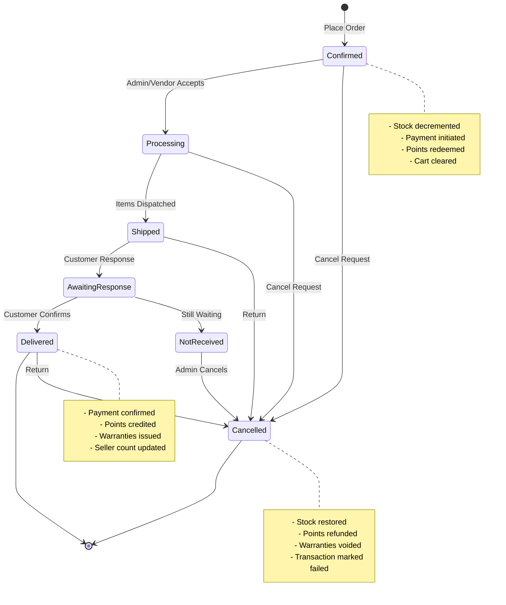
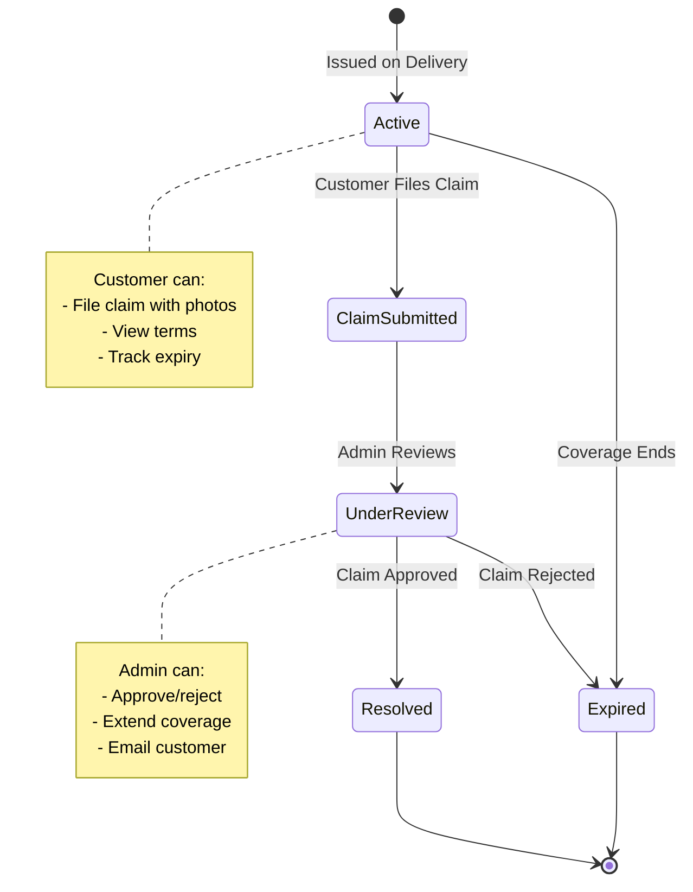

<div align="center">

# ⚡ Sparq — Frontend

### *Full-stack electronics e-commerce platform*

**Next.js 16 + React 19 storefront with role-based dashboards, multi-vendor marketplace, loyalty system and comprehensive CMS**

[](https://sparq-electronics.vercel.app)
[](https://github.com/demoprojectbdsoft/Sparq-Electronics-Store)
[](https://github.com/demoprojectbdsoft/Sparq-Server)

</div>

---

## 📑 Table of Contents

1. [Overview](#-overview)
2. [System Architecture](#-system-architecture)
3. [Features by Role](#-features-by-role)
4. [Core Features](#-core-features)
5. [Tech Stack](#-tech-stack)
6. [Project Structure](#-project-structure)
7. [Setup & Installation](#-setup--installation)
8. [Environment Variables](#-environment-variables)
9. [Development](#-development)
10. [Deployment](#-deployment)
11. [Project Status](#-project-status)
12. [Contributing](#-contributing)
13. [License](#-license)

---

## 📖 Overview

Sparq is a comprehensive, production-ready e-commerce platform built for electronics retail with complete multi-vendor marketplace capabilities. Every aspect of the store — from branding and catalog to pricing and policies — is managed through an intuitive admin dashboard, with no hardcoded values.

### What Makes Sparq Different

**🎨 Completely Database-Driven**
- Site name, logos, colors, fonts, and all content managed via dashboard
- No redeploy needed for branding changes
- Industry-specific color palettes (electronics, jewelry, fashion, etc.)
- Dynamic theme system with light/dark mode support

**🏪 Multi-Vendor Marketplace**
- Independent seller storefronts with custom branding
- Separate inventory, order fulfillment, and analytics per vendor
- Tiered subscription plans with feature limits
- Featured product promotions and discount coupons

**👥 Role-Based Architecture**
- **Customers**: Shopping, orders, reviews, warranties
- **Admins**: Full platform control and reporting
- **Vendors**: Product management, fulfillment, analytics
- **Riders**: Delivery tracking and order logistics
- **Demo Admin**: Sandboxed exploration with automatic restore

**💳 Complete Commerce Workflow**
- Cart, wishlist, and product comparison
- Multiple payment methods (COD, mobile wallets)
- Loyalty points system with membership tiers
- Comprehensive warranty management and claims

---

## 🏗 System Architecture



### Authentication Flow



### Order Processing Flow



---

## 🎭 Features by Role

### 🛍️ Customer (Shopper)

<details open>
<summary><b>Storefront Features</b></summary>

- **Product Discovery**
  - Advanced search with filters (category, price, brand, rating)
  - Dual browse modes: pagination or infinite scroll
  - Product comparison (up to 3 items)
  - Wishlist with multi-device sync

- **Shopping Experience**
  - Dynamic cart with real-time totals
  - Multiple checkout options (COD, mobile wallet)
  - Saved shipping addresses (up to 5)
  - Reward points redemption at checkout
  - Discount coupon support

- **Order Management**
  - Real-time order tracking with delivery map
  - Order history with invoice PDF downloads
  - "Buy Again" for quick reordering
  - Delivery confirmation workflow

- **Engagement**
  - Product reviews with image uploads
  - Star ratings (recalculated live)
  - Warranty claims with photo evidence
  - Profile customization

</details>

<details>
<summary><b>Customer Dashboard</b></summary>

- **Overview**: Spending analytics, recent orders, savings charts
- **Orders**: Full history, tracking, invoices, warranty cards
- **Transactions**: Payment records with PDF receipts
- **Wishlist**: Saved products with quick add-to-cart
- **Reviews**: Manage submitted reviews with edit support
- **Profile**: Personal details, saved addresses
- **Settings**: 
  - Currency and language preferences
  - Notification management
  - Password and security
  - Data export (JSON) and account deletion

</details>

### 👨‍💼 Admin (Store Manager)

<details>
<summary><b>Store Management</b></summary>

- **Product Catalog**
  - Add/edit/delete products with image uploads
  - Stock management (optional tracking)
  - Badge system (New, Sale, Featured)
  - Profit/loss tracking per product

- **Category Management**
  - Hierarchical categories and subcategories
  - Cascade delete protection

- **Homepage Control**
  - Hero slider with countdown timers
  - Promo banners (tiles and strips)
  - Featured products and shops
  - Brand marquee management

- **Order Fulfillment**
  - Platform-wide order visibility
  - Status management workflow
  - Multi-vendor order coordination
  - Delivery assignment to riders

</details>

<details>
<summary><b>User & Vendor Management</b></summary>

- **User Accounts**
  - Role assignment and revocation
  - Per-role suspension (without full account ban)
  - Points and membership tier management

- **Vendor Applications**
  - Review applications
  - Approve/reject with reasons
  - Store visibility controls

- **Featured Promotions**
  - Grant featured slots to products/shops
  - Set custom durations (1-365 days)
  - Monitor active placements

</details>

<details>
<summary><b>Support & Communication</b></summary>

- **Reviews**: Moderate product reviews
- **Warranties**: Process claims, extend coverage, email customers
- **Messages**: Contact form submissions with reply support
- **Notifications**: Unified activity feed with email delivery

</details>

<details>
<summary><b>Site Settings & Branding</b></summary>

- **Identity**: Name, slogan, SEO meta
- **Typography**: Google Fonts selection
- **Theme**: Industry palettes + custom color creator
- **Logos**: Light/dark variants, favicon
- **Shipping**: Fees, thresholds, delivery estimates
- **Contact**: Phone, email, social links, hours
- **System**: Currency, timezone, maintenance mode

</details>

<details>
<summary><b>Reports & Analytics</b></summary>

- Revenue and order trends (day/week/month/year)
- Top-selling and highest-earning products
- Customer analytics
- CSV and PDF exports with charts

</details>

### 🏪 Vendor (Seller)

<details>
<summary><b>Storefront & Products</b></summary>

- **Store Profile**: Branding, description, contact, cover image
- **Product Catalog**: Add/edit/archive with plan limits
- **Status Management**: Draft → Published → Out of Stock
- **Featured Promotions**: Buy product slots from subscription plan

</details>

<details>
<summary><b>Order Fulfillment</b></summary>

- **Order Groups**: Own items from multi-vendor orders
- **Workflow**: Pending → Accepted → Processing → Ready
- **Pickup Requests**: Notify platform for rider assignment
- **Order Detail**: Customer info, delivery tracking

</details>

<details>
<summary><b>Marketing & Growth</b></summary>

- **Discount Coupons**: Create codes with plan limits
- **Analytics**: Sales reports (windowed by plan tier)
- **Sales Tracking**: Revenue, commission, top products

</details>

<details>
<summary><b>Plan & Billing</b></summary>

- **Subscription Tiers**: Free, Basic, Pro
- **Plan Limits**: Products, coupons, featured slots, analytics depth
- **Billing**: Monthly/yearly cycles with demo checkout
- **Usage Tracking**: Real-time limit monitoring

</details>

### 🛵 Rider (Delivery Partner)

<details>
<summary><b>Delivery Management</b></summary>

- **Dashboard**: Earnings, completed deliveries, pipeline breakdown
- **Requests**: Incoming delivery offers with expiry
- **Active Deliveries**: Current jobs with tracking
- **History**: Completed and cancelled jobs
- **Earnings**: Total, monthly, and per-job averages

</details>

<details>
<summary><b>Profile & Settings</b></summary>

- **Profile**: Vehicle info, license details, photo
- **Availability**: Online/offline toggle
- **Settings**: Password, notifications
- **Exports**: CSV and PDF reports

</details>

### 🧪 Demo Admin

<details>
<summary><b>Sandboxed Exploration</b></summary>

- **Full Catalog Access**: Add, edit, delete products/categories
- **Review Moderation**: Manage reviews
- **Protected Data**: Cannot modify users, orders, site settings
- **Daily Restore**: All changes reverted at midnight
- **Demo Badge**: Visible indicator across dashboard

</details>

---

## 🎯 Core Features

### 🔐 Authentication & Authorization

- **Email/Password** and **Google OAuth** via better-auth
- **JWT tokens** with JWKS verification
- **Role-based access control** (RBAC) with per-role suspension
- **Password reset** via email with one-time links
- **Session management** with revocation

### 🛒 Shopping Experience

**Cart & Wishlist**
- Database-synced across devices
- Real-time price and stock updates
- Quantity management
- Guest comparison (localStorage)

**Checkout**
- COD and mobile wallet (bKash/Rocket/Nagad) with OTP
- Saved address autofill
- Reward points redemption
- Coupon code validation
- Real-time shipping calculation

**Product Discovery**
- Search with debouncing
- Multi-criteria filtering
- Sort options (newest, price, rating, popularity)
- Pagination or infinite scroll (user preference)

### 💰 Loyalty & Rewards

**Points System**
```
Earning:    1 point per currency unit spent (on discounted total)
Redemption: 100 points = 1 currency unit
Minimum:    100 points to redeem
Limit:      Can only cover product cost (not shipping)
```

**Membership Tiers**
- 🥈 **Silver**: < 1,000 points
- 🥇 **Gold**: 1,000 - 3,999 points
- 💎 **Platinum**: 4,000 - 9,999 points
- 💎 **Diamond**: 10,000+ points

### 🛡️ Warranty Management

**Coverage Types**
- **Manufacturer Warranty**: Brand handles repairs
- **Seller Warranty**: Platform handles repairs
- **Extended Warranty**: Extra coverage beyond standard
- **Other**: Custom warranty terms

**Warranty Workflow**


### 📊 Analytics & Reporting

**Customer Reports**
- Spending trends
- Savings from discounts/points
- Order history
- CSV and PDF exports

**Admin Reports**
- Revenue by period (day/week/month/year)
- Top products by sales and profit
- Customer acquisition
- Order pipeline status

**Vendor Reports** (Plan-Limited)
- Sales revenue and commission
- Top products (3/10/20 based on plan)
- Analytics window (30/90/365 days)
- Export capabilities (limited/full)

### 🎨 Dynamic Branding (CMS)

**Everything is Editable**
- Site name, tagline, logos (light/dark)
- Color palettes (8 industry presets + custom)
- Typography (curated Google Fonts)
- Homepage hero slider
- Promo banners and strips
- About page content
- Contact information
- Opening hours
- Social media links

**Built-in Industry Palettes**
- Electronics (current)
- Jewelry
- Fashion
- Restaurant
- Bakery
- Coffee Shop
- Plants & Garden
- Robotics & Tech

### 🔧 Maintenance Mode

**Controlled Site Closure**
- Admins retain full access
- Customers redirected to branded page
- Live status checking (3-second intervals)
- Automatic restore after reactivation
- Preview mode for admins

### 🏬 Multi-Vendor Marketplace

**Vendor Storefronts**
- Custom branding per shop
- Public catalog at `/stores/<slug>`
- Store discovery page with search/filters
- Featured shops rail on homepage

**Order Splitting**
- One payment, multiple fulfillments
- Each vendor manages own items
- Independent status tracking
- Platform coordinates delivery

**Subscription Plans**

| Feature | Free | Basic | Pro |
|---------|------|-------|-----|
| **Products** | 10 | 50 | Unlimited |
| **Coupons** | 2 active | 10 active | Unlimited |
| **Featured Products** | 1 slot / 7 days | 3 slots / 14 days | 10 slots / 30 days |
| **Analytics Window** | 30 days | 90 days | 365 days |
| **Commission** | 15% | 10% | 5% |
| **Price (Monthly)** | Free | $29 | $99 |
| **Price (Yearly)** | Free | $290 ($24/mo) | $990 ($82/mo) |

---

## 🧰 Tech Stack

### Frontend

| Layer | Technology |
|-------|-----------|
| **Framework** | Next.js 16.2 (App Router), React 19 |
| **Language** | TypeScript 5 |
| **Styling** | Tailwind CSS v4, HeroUI v3 |
| **Auth** | better-auth 1.7 (JWT, MongoDB adapter) |
| **State** | React Context, Server Components |
| **Theme** | next-themes (light/dark) |
| **Icons** | Lucide React, React Icons |
| **Charts** | Recharts |
| **PDF** | jsPDF (client-side generation) |
| **Maps** | Leaflet + OpenStreetMap |
| **Forms** | react-aria-components |
| **Animation** | react-fast-marquee |
| **Toast** | react-toastify |

### Backend

| Layer | Technology |
|-------|-----------|
| **Runtime** | Node.js 20+ |
| **Framework** | Express 5.2 |
| **Language** | TypeScript (CommonJS) |
| **Database** | MongoDB 7 + Mongoose 9 |
| **Validation** | Zod 4 |
| **Auth** | jose-cjs (JWKS verification) |
| **Email** | Nodemailer (SMTP) |
| **Jobs** | node-cron + Vercel Cron |
| **Image Host** | ImgBB API |

### Infrastructure

- **Hosting**: Vercel (Frontend + Backend serverless)
- **Database**: MongoDB Atlas
- **CDN**: ImgBB for images
- **Email**: SMTP (Gmail, custom domain)
- **Maps**: OpenStreetMap (no API key)

---

## 📁 Project Structure

```
sparq/
├── src/
│   ├── app/
│   │   ├── (auth)/                    # Authentication pages
│   │   │   └── auth/
│   │   │       ├── login/
│   │   │       ├── register/
│   │   │       ├── forgot-password/
│   │   │       └── reset-password/
│   │   │
│   │   ├── (dashboard)/               # Role-based dashboards
│   │   │   └── dashboard/
│   │   │       ├── admin/             # Admin: catalog, orders, users, settings
│   │   │       ├── customer/          # Customer: orders, reviews, wishlist
│   │   │       ├── vendor/            # Vendor: products, orders, analytics
│   │   │       └── rider/             # Rider: deliveries, earnings
│   │   │
│   │   ├── (main)/                    # Public storefront
│   │   │   ├── page.tsx               # Homepage
│   │   │   ├── shop/                  # Product catalog
│   │   │   ├── stores/                # Vendor storefronts
│   │   │   ├── cart/
│   │   │   ├── checkout/
│   │   │   ├── compare/
│   │   │   ├── track-order/
│   │   │   ├── order-success/
│   │   │   ├── become-a-vendor/
│   │   │   ├── about/
│   │   │   ├── contact/
│   │   │   └── ...
│   │   │
│   │   ├── api/
│   │   │   └── auth/[...all]/         # better-auth endpoints
│   │   │
│   │   ├── maintenance/               # Maintenance mode page
│   │   ├── forbidden/                 # 403 page
│   │   ├── layout.tsx                 # Root layout
│   │   ├── providers.tsx              # Context providers
│   │   ├── globals.css                # Global styles
│   │   └── proxy.ts                   # Middleware (maintenance guard)
│   │
│   ├── components/
│   │   ├── dashboard/                 # Dashboard UI components
│   │   │   ├── AdminSidebar.tsx
│   │   │   ├── CustomerSidebar.tsx
│   │   │   ├── VendorSidebar.tsx
│   │   │   ├── RiderSidebar.tsx
│   │   │   └── NotificationBell.tsx
│   │   │
│   │   ├── homepage/                  # Homepage sections
│   │   │   ├── HeroSlider.tsx
│   │   │   ├── PromoBanners.tsx
│   │   │   ├── TrendingProducts.tsx
│   │   │   └── BrandMarquee.tsx
│   │   │
│   │   ├── shared/                    # Reusable components
│   │   │   ├── Navbar.tsx
│   │   │   ├── Footer.tsx
│   │   │   ├── ProductCard.tsx
│   │   │   ├── StatusBadge.tsx
│   │   │   ├── ImageUploader.tsx
│   │   │   ├── AppSelect.tsx
│   │   │   ├── AppDatePicker.tsx
│   │   │   └── ...
│   │   │
│   │   ├── shop/                      # Shop-specific
│   │   │   ├── ProductsGrid.tsx
│   │   │   ├── ProductsSidebarFilter.tsx
│   │   │   └── ProductsTopBar.tsx
│   │   │
│   │   ├── tracking/                  # Order tracking
│   │   │   ├── TrackingView.tsx
│   │   │   └── DeliveryMap.tsx
│   │   │
│   │   └── vendor/                    # Vendor components
│   │       ├── VendorApplicationWizard.tsx
│   │       └── PlanCards.tsx
│   │
│   ├── context/
│   │   └── SiteSettingsContext.tsx    # Global site settings provider
│   │
│   ├── hooks/
│   │   ├── useDemoAdmin.ts            # Demo admin write guard
│   │   └── useRiderLocation.ts        # Geolocation for riders
│   │
│   ├── lib/
│   │   ├── api/                       # Server-side API clients
│   │   │   ├── products.ts
│   │   │   ├── orders.ts
│   │   │   ├── users.ts
│   │   │   └── ...
│   │   │
│   │   ├── action/                    # Server actions (mutations)
│   │   │   ├── cart.ts
│   │   │   ├── orders.ts
│   │   │   ├── reviews.ts
│   │   │   └── ...
│   │   │
│   │   ├── core/                      # Core utilities
│   │   │   ├── server.ts              # API client
│   │   │   ├── session.ts             # Auth helpers
│   │   │   ├── roles.ts               # Role guards
│   │   │   └── query.ts               # Query builders
│   │   │
│   │   ├── auth.ts                    # better-auth config
│   │   ├── auth-client.ts             # Client-side auth
│   │   ├── compare.ts                 # Product comparison (localStorage)
│   │   ├── currency.ts                # Currency formatting
│   │   ├── csvExport.ts               # CSV report generation
│   │   ├── dashboardPdf.ts            # PDF reports with charts
│   │   ├── orderInvoicePdf.ts         # Order invoice PDF
│   │   ├── transactionReceiptPdf.ts   # Transaction receipt PDF
│   │   ├── notifications.ts           # Notification routing
│   │   ├── orderStatusStyles.ts       # Status badge styling
│   │   ├── warranty.ts                # Warranty utilities
│   │   └── ...
│   │
│   └── types/
│       ├── index.ts                   # Core types
│       ├── checkout.ts                # Order types
│       ├── delivery.ts                # Delivery types
│       ├── vendor.ts                  # Vendor types
│       ├── warranty.ts                # Warranty types
│       └── ...
│
├── public/                            # Static assets
│   ├── icon.svg                       # App icon
│   ├── sparq-logo-dark.png
│   └── ...
│
├── .env.local                         # Environment variables (gitignored)
├── next.config.ts                     # Next.js configuration
├── tailwind.config.ts                 # Tailwind configuration
├── tsconfig.json                      # TypeScript configuration
├── package.json
└── README.md
```

---

## 🚀 Setup & Installation

### Prerequisites

- **Node.js** 20+ and npm
- **MongoDB** (local or Atlas)
- **SMTP credentials** (for emails)
- **ImgBB API key** (for image uploads)
- **Google OAuth** credentials (optional)

### Backend Setup

The backend API must be running before the frontend. Follow the [Sparq-Server README](https://github.com/demoprojectbdsoft/Sparq-Server) for complete setup instructions.

Quick start:
```bash
git clone https://github.com/demoprojectbdsoft/Sparq-Server.git
cd Sparq-Server
npm install
# Configure .env.local
npm run dev
```

### Frontend Setup

1. **Clone the repository**
```bash
git clone https://github.com/demoprojectbdsoft/Sparq-Electronics-Store.git
cd Sparq-Electronics-Store
```

2. **Install dependencies**
```bash
npm install
```

3. **Configure environment variables**

Create `.env.local` in the project root:

```env
# Backend API
NEXT_PUBLIC_API_URL=http://localhost:5000/api

# better-auth
BETTER_AUTH_URL=http://localhost:3000
BETTER_AUTH_SECRET=your_long_random_secret_here
JWT_SECRET=your_jwt_secret_here

# MongoDB (same database as backend)
MONGODB_URI=mongodb://localhost:27017
DATABASE=sparq

# Google OAuth (optional)
GOOGLE_CLIENT_ID=your_google_client_id
GOOGLE_CLIENT_SECRET=your_google_client_secret

# Internal API key (must match backend INTERNAL_API_KEY)
INTERNAL_API_KEY=your_internal_api_key

# Image uploads
NEXT_PUBLIC_IMGBB_API_KEY=your_imgbb_api_key
```

4. **Start the development server**
```bash
npm run dev
```

Open [http://localhost:3000](http://localhost:3000) in your browser.

---

## 🔐 Environment Variables

### Required Variables

| Variable | Description | Example |
|----------|-------------|---------|
| `NEXT_PUBLIC_API_URL` | Backend API base URL | `http://localhost:5000/api` |
| `BETTER_AUTH_SECRET` | Signs sessions and tokens | Random 32+ char string |
| `BETTER_AUTH_URL` | This app's URL | `http://localhost:3000` |
| `NEXT_PUBLIC_CLIENT_URL` | Frontend URL (for JWKS) | Same as `BETTER_AUTH_URL` |
| `MONGODB_URI` | MongoDB connection string | `mongodb://localhost:27017` |
| `DATABASE` | Database name | `sparq` |
| `INTERNAL_API_KEY` | Shared secret with backend | Random 32+ char string |

### Optional Variables

| Variable | Description |
|----------|-------------|
| `GOOGLE_CLIENT_ID` | Google OAuth client ID |
| `GOOGLE_CLIENT_SECRET` | Google OAuth client secret |
| `NEXT_PUBLIC_IMGBB_API_KEY` | ImgBB API key for image uploads |

### Important Notes

- **Never commit `.env.local`** — add it to `.gitignore`
- **`NEXT_PUBLIC_*` variables** are baked into the client bundle at build time
- **Rebuild after changing** any `NEXT_PUBLIC_*` variable
- **`INTERNAL_API_KEY`** must match the backend's value exactly
- **Email is sent by the backend** — configure SMTP on the server, not here

---

## 💻 Development

### Available Scripts

```bash
# Development server with hot reload
npm run dev

# Production build
npm run build

# Start production server
npm start

# Run ESLint
npm run lint

# Type checking
npm run type-check
```

### Development Workflow

1. **Run backend first** at `http://localhost:5000`
2. **Start frontend** at `http://localhost:3000`
3. **Test with demo accounts**:
   - Admin: Use site settings to create admin account
   - Customer: Register via `/auth/register`
   - Demo Admin: Configure `DEMO_ADMIN_EMAIL` in backend

### Code Organization

**Server Components** (default in App Router)
- Pages fetch data directly via `lib/api/*`
- No client-side data fetching boilerplate
- Automatic request deduplication

**Client Components** (`"use client"`)
- Interactive UI elements
- Named `*Client.tsx` by convention
- Use server actions for mutations

**Server Actions** (`"use server"`)
- Located in `lib/action/*`
- Handle mutations (cart, orders, reviews)
- Automatic revalidation

### Adding a New Feature

1. **Define types** in `src/types/`
2. **Create API client** in `src/lib/api/`
3. **Add server action** in `src/lib/action/` (if mutation)
4. **Build UI components** in `src/components/`
5. **Create page** in `src/app/`
6. **Add backend route** (see backend README)

---

## 🚀 Deployment

### Vercel Deployment (Recommended)

**Frontend Deployment:**

1. Push code to GitHub
2. Import repository to Vercel
3. Configure environment variables
4. Deploy

**Environment Setup:**
```env
NEXT_PUBLIC_API_URL=https://your-api.vercel.app/api
BETTER_AUTH_URL=https://your-app.vercel.app
BETTER_AUTH_SECRET=<production-secret>
JWT_SECRET=<production-secret>
MONGODB_URI=<atlas-connection-string>
DATABASE=sparq
GOOGLE_CLIENT_ID=<production-client-id>
GOOGLE_CLIENT_SECRET=<production-client-secret>
INTERNAL_API_KEY=<shared-with-backend>
NEXT_PUBLIC_IMGBB_API_KEY=<imgbb-key>
```

### Production Checklist

- [ ] Update all `NEXT_PUBLIC_API_URL` to production backend
- [ ] Set production `BETTER_AUTH_SECRET` and `JWT_SECRET`
- [ ] Configure MongoDB Atlas whitelist
- [ ] Set up production Google OAuth credentials
- [ ] Configure SMTP for emails (backend)
- [ ] Enable production error logging
- [ ] Set `NODE_ENV=production`
- [ ] Test all user flows
- [ ] Verify maintenance mode works
- [ ] Check mobile responsiveness

---

## 📊 Project Status

| Feature | Status |
|---------|--------|
| **Public Storefront** | ✅ Complete |
| **Customer Dashboard** | ✅ Complete |
| **Admin Dashboard** | ✅ Complete |
| **Vendor Application** | ✅ Complete |
| **Vendor Dashboard** | ✅ Complete |
| **Rider Dashboard** | ✅ Complete (Phase 2/7) |
| **Multi-Vendor Orders** | ✅ Complete |
| **Discount Coupons** | ✅ Complete |
| **Featured Promotions** | ✅ Complete |
| **Warranty System** | ✅ Complete |
| **Loyalty Points** | ✅ Complete |
| **Notifications** | ✅ Complete |
| **CMS (Site Settings)** | ✅ Complete |
| **Maintenance Mode** | ✅ Complete |
| **Demo Admin Mode** | ✅ Complete |
| **Live Delivery Tracking** | 🚧 In Progress |
| **Real Payment Gateway** | 📋 Planned |
| **Mobile Apps** | 📋 Planned |
| **Internationalization** | 📋 Planned |

---

## 🗺️ Roadmap

### Phase 1: Core Platform ✅
- [x] Authentication and authorization
- [x] Product catalog
- [x] Shopping cart and checkout
- [x] Order management
- [x] Customer dashboard

### Phase 2: Multi-Vendor ✅
- [x] Vendor application workflow
- [x] Vendor dashboard
- [x] Multi-vendor order splitting
- [x] Subscription plans
- [x] Discount coupons
- [x] Featured promotions

### Phase 3: Delivery System 🚧
- [x] Rider role and dashboard
- [x] Delivery assignment
- [ ] Live GPS tracking
- [ ] OTP verification
- [ ] Delivery completion

### Phase 4: Advanced Features 📋
- [ ] Real payment gateway integration
- [ ] Advanced analytics and BI
- [ ] Email marketing automation
- [ ] Inventory forecasting
- [ ] Customer segmentation

### Phase 5: Mobile & Scale 📋
- [ ] React Native mobile apps
- [ ] Push notifications
- [ ] Offline mode
- [ ] Performance optimization
- [ ] CDN integration

---

## 🤝 Contributing

Contributions are welcome! This is a demonstration project, but improvements and bug fixes are appreciated.

### How to Contribute

1. Fork the repository
2. Create a feature branch (`git checkout -b feature/AmazingFeature`)
3. Commit your changes (`git commit -m 'Add some AmazingFeature'`)
4. Push to the branch (`git push origin feature/AmazingFeature`)
5. Open a Pull Request

### Development Guidelines

- Follow existing code structure and naming conventions
- Write TypeScript with proper types
- Test thoroughly before submitting
- Update documentation for new features
- Keep commits atomic and well-described

---

## 📄 License

This project is licensed under the MIT License. See [LICENSE](LICENSE) for details.

---

## 🙏 Acknowledgments

**Built by:** [BD Soft](https://github.com/demoprojectbdsoft)

**Technologies:**
- [Next.js](https://nextjs.org/) - React framework
- [better-auth](https://better-auth.com/) - Authentication
- [HeroUI](https://heroui.com/) - Component library
- [Tailwind CSS](https://tailwindcss.com/) - Styling
- [MongoDB](https://www.mongodb.com/) - Database
- [Vercel](https://vercel.com/) - Hosting

---

## 📞 Support

- **Documentation**: [Backend README](https://github.com/demoprojectbdsoft/Sparq-Server)
- **Issues**: [GitHub Issues](https://github.com/demoprojectbdsoft/Sparq-Electronics-Store/issues)
- **Email**: support@bdsoft.com

---

<div align="center">

**⚡ Sparq — Better products. A brighter you.**

Made with ❤️ by [BD Soft](https://github.com/demoprojectbdsoft)

[⬆ Back to Top](#-sparq--frontend)

</div>
