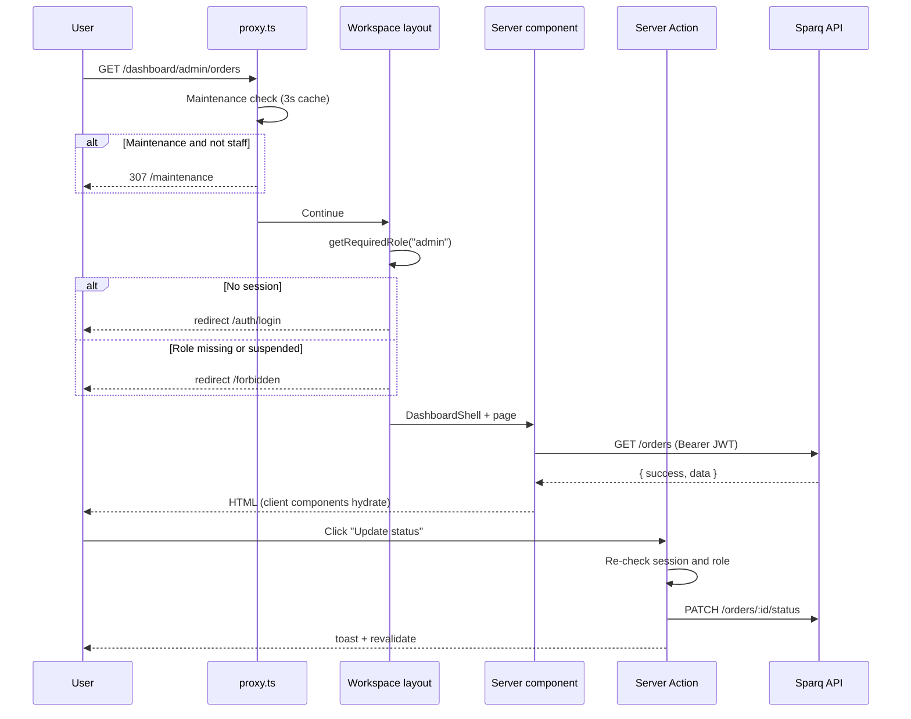
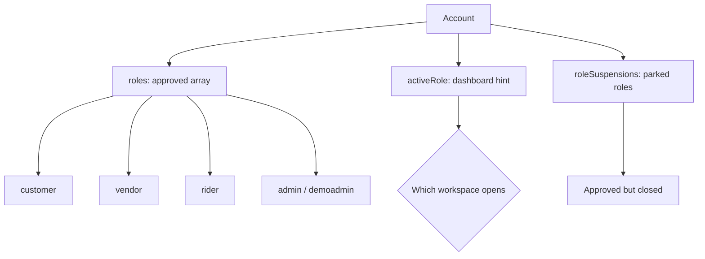
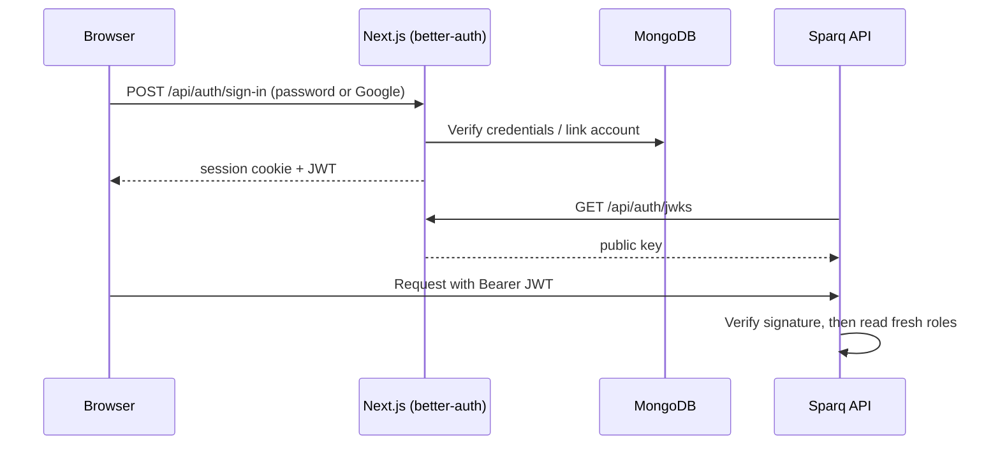

<div align="center">

# ⚡ Sparq — Storefront & Dashboards

### *Next.js frontend for a full-stack e-commerce platform*

**Next.js 16 App Router + better-auth powering the shop, live delivery tracking, and four role dashboards (customer, vendor, rider, admin)**

[](https://github.com/demoprojectbdsoft/Sparq-Electronics-Store)
[](https://github.com/demoprojectbdsoft/Sparq-Server)
[](https://sparq-api.vercel.app/api)

</div>

---

## 📑 Table of Contents

1. [Overview](#-overview)
2. [Features](#-features)
3. [Architecture](#️-architecture)
4. [Pages & Routes](#-pages--routes)
5. [Security](#-security)
6. [Tech Stack](#-tech-stack)
7. [Project Structure](#-project-structure)
8. [Setup & Installation](#-setup--installation)
9. [Environment Variables](#-environment-variables)
10. [Development](#-development)
11. [Deployment](#-deployment)
12. [Project Status](#-project-status)
13. [Contributing](#-contributing)
14. [License](#-license)

---

## 📖 Overview

Sparq is the customer-facing storefront and the dashboard suite for the [Sparq](https://github.com/demoprojectbdsoft/Sparq-Server) marketplace: one Next.js app that serves shoppers, sellers, riders and the store team, plus a demo admin account.

### Core Responsibilities

**✅ What This App Owns**

| Responsibility | Description |
|---------------|-------------|
| **Authentication** | Sign-up, login, Google sign-in, sessions, password reset, JWTs (better-auth) |
| **Sessions & JWTs** | Session storage in MongoDB, `/api/auth/jwks` for the API to verify tokens |
| **All UI** | Storefront, four dashboards, wizards, tracking map, modals, toasts |
| **Data Access** | Typed API clients (`lib/api`) and server actions (`lib/action`) |
| **Documents & Exports** | Invoice and receipt PDFs, report PDFs, CSV exports |
| **Brand** | Colours, logos, favicon and the PWA manifest, all driven by Site Settings |
| **Maintenance Gate** | `/maintenance` for shoppers while staff keep working |

**❌ What This App Does NOT Own**

- **Pricing & Totals**: computed by the API on every order, never here
- **Stock, payments, points**: written by the API inside a transaction
- **Outbound email**: the API owns the SMTP mailbox and the templates
- **Delivery state**: rider steps, hand-over codes and payouts live in the API

### System Architecture

```mermaid
graph TB
    subgraph "Browser"
        A[Visitor / Account]
    end

    subgraph "Next.js (this repo)"
        B[proxy.ts maintenance gate]
        C[(main) storefront]
        D[(dashboard) workspaces]
        E[better-auth /api/auth/*]
        F[Server Actions]
        G[API client lib/api]
    end

    subgraph "Sparq API"
        H[Express 5 + MongoDB]
    end

    subgraph "Third party"
        I[SMTP via API]
        J[ImgBB image host]
        K[Google Translate widget]
    end

    A --> B
    B --> C
    B --> D
    C --> F
    D --> F
    F --> G
    A --> E
    E -->|session + JWT| A
    G -->|Bearer JWT| H
    H -->|reset mail| I
    C --> J
    D --> J
    C --> K
```

### Request Flow



---

## 🧩 Features

### Storefront

| Area | What it does |
|------|--------------|
| **Home** | Hero slider, promo banners, category rail, featured products, brand marquee — all editable from Site Settings |
| **Shop** | Search, category and subcategory filters, price and discount ranges, badges, rating filter, sorting and pagination |
| **Product page** | Gallery with a full-size viewer, stock state, offer countdown, specification table, warranty card, reviews and related items |
| **Compare** | Up to 3 listings side by side (price, rating, availability, warranty, full specifications), kept in the browser |
| **Cart & wishlist** | Add, update quantity, remove, clear; out-of-stock items are flagged before checkout |
| **Checkout** | Saved addresses, COD / bKash / Rocket / Nagad, coupon code, reward points, shipping method and live totals from the API |
| **Order success** | Official purchase receipt with a printable/downloadable copy and the tracking link |
| **Track order** | Live Leaflet map with the rider's last position, the step timeline and the hand-over code; the delivery outcome is recorded from the customer's orders screen |
| **Stores** | Public seller directory, vendor storefront pages and a store locator |
| **Content** | About, services, FAQ, support, customer service, privacy, terms, returns, not-found and maintenance pages |
| **Onboarding** | Become a vendor and become a rider wizards (multi-step, documents, autosaved draft) plus status pages |
| **Extras** | Dark/light theme, 14-language switcher (Google Translate), PWA manifest, dynamic favicon, floating mobile actions |

### Customer Dashboard

- Order history with invoice PDF, per-item detail, buy again and delivery response
- Wishlist, reviews, notifications, transactions
- Profile and settings (addresses, account deletion, personal data export as JSON)

### Vendor Dashboard

- Order queue with per-seller stages (`accepted` → `processing` → `ready_for_shipment`, or `rejected` with a reason)
- Product list and editor (images, variants, specifications, warranty fields, offers, badges)
- Promotions, coupons, deliveries, payouts, transactions, reviews
- Analytics with the plan's entitlement ladder, subscription desk and plan upgrade
- Store profile, availability and settings

### Rider Dashboard

- Offer requests with the countdown window, accept or decline with a reason
- Active job with the live steps, the buyer's hand-over code entry and the pick-up location
- Deliveries list, earnings (this month and a 30-day window) and history
- Profile (identity, vehicle, documents) and settings (availability, password)

### Admin Dashboard

| Screen | What it does |
|--------|--------------|
| **Overview** | Counts, KPI cards, a store health bar and the orders that just came in (charts live under Analytics) |
| **Products** | Add, edit, detail view, visibility and featured state, offer windows |
| **Categories & subcategories** | Full CRUD |
| **Orders** | Every order, status changes, customer response, invoice PDF |
| **Deliveries** | Assign a rider, reassign, cancel, delivery board and history |
| **Riders** | Rider list, detail page and the application review desk |
| **Payouts** | What each delivered job paid the rider, with range filters and a chart |
| **Vendors** | Vendor list, store profiles, plans and applications |
| **Vendor plans** | The editable price list behind the pricing cards |
| **Promotions & coupons** | Featured placements, store coupons, banner and slider CMS |
| **Analytics** | Sales report, vendor desk (subscriptions + commission) and product engagement, with CSV/PDF export |
| **Users** | Search, roles, per-role suspension, detail page |
| **Messages** | Contact-form inbox with replies |
| **Reviews** | Moderation across the catalogue |
| **Settings** | Site CMS: branding, colours, typography, logos, favicon, top bar, shipping and loyalty rates, legal and about content, maintenance toggle |
| **Notifications & transactions** | Activity feed and payment records |

### Shared Behaviour

- Notification bell and centre with unread counts and per-type deep links
- PDFs: order invoice, delivery payout invoice, transaction receipt, analytics report
- CSV export from the analytics and payout screens
- Image uploads to ImgBB; application documents go through a server-side proxy
- Skeletons, empty states, toasts, unsaved-changes guards and autosaved wizard drafts

---

## 🏗️ Architecture

### Route Groups

```
src/app/
├── (auth)/auth/           # login, register, forgot-password, reset-password
├── (main)/                # storefront: shop, cart, checkout, track-order, content
├── (dashboard)/dashboard/ # admin, vendor, rider, customer workspaces
├── api/auth/[...all]/     # better-auth handler (also serves /api/auth/jwks)
├── api/documents/         # authenticated file proxy to the API
├── api/maintenance/       # maintenance status for the gate
├── forbidden/             # the refusal screen
└── maintenance/           # the maintenance screen
```

### Data Flow

```
page.tsx (server component)
  → lib/api/*            typed fetch, cache: "no-store", Bearer token
  → Client component     props only, no secrets
  → lib/action/*         "use server" mutation, re-checks the session
  → revalidate / toast
```

- **`lib/api`** — read side: one function per endpoint, typed responses, currency and date helpers
- **`lib/action`** — write side: server actions that read the session, call the API, report errors as toasts and revalidate paths
- **`lib/core`** — `session` (session, token, role guard), `roles` (role pools, suspension, workspace map), `mongo`, `query`, `server`
- **`context`** — `SiteSettingsContext` (brand values for client components) and `RiderLocationContext` (live position)
- **`hooks`** — countdown, dashboard role, demo admin, rider location, wizard draft

### Workspace Chrome

```
(dashboard)/layout.tsx           ← pass-through only, draws nothing
(dashboard)/dashboard/admin/layout.tsx    ← getRequiredRole("admin") → DashboardShell
(dashboard)/dashboard/vendor/layout.tsx   ← getRequiredRole("vendor") → DashboardShell
(dashboard)/dashboard/rider/layout.tsx    ← getRequiredRole("rider")  → DashboardShell
(dashboard)/dashboard/customer/layout.tsx ← getRequiredRole("customer") → DashboardShell
```

The sidebar, header and mobile bar are mounted **after** the guard, so an account that does not hold a role never receives that workspace's navigation, not even for one frame. `DashboardShell` decides which sidebar to draw from the URL, and the session is only the fallback for routes outside a workspace.

### Role Model



- `roles` is the source of truth; `activeRole` only points the shell
- A suspended role stays approved but its dashboard refuses entry
- `admin` covers `demoadmin`; a customer entry is always present for non-admin accounts
- `resolveActiveRole`, `canEnterWorkspace` and `resolveWorkspace` keep the switcher and the guards on the same answer

### Maintenance Mode

```mermaid
graph LR
    A[Request] --> B{Exempt path?}
    B -->|static, /auth, /api/auth| C[Allow]
    B -->|no| D{Maintenance on?}
    D -->|off| C
    D -->|on| E{Admin or demo admin?}
    E -->|yes| C
    E -->|no| F[/maintenance]
```

The flag is read from the API's `/site-settings` with a 3-second cache; the session is checked against `/api/auth/get-session` with a 30-second per-cookie cache. If the API is unreachable the last known value is kept, so a backend hiccup cannot lock the shop.

---

## 🗺️ Pages & Routes

### Storefront

| Route | Purpose |
|-------|---------|
| `/` | Home |
| `/shop` | Catalogue with filters and sorting |
| `/shop/[slug]` | Product detail |
| `/compare` | Side-by-side comparison (max 3) |
| `/cart`, `/checkout` | Cart and checkout |
| `/order-success`, `/order-success/[orderId]` | Receipt |
| `/track-order`, `/track-order/[orderId]` | Live tracking |
| `/stores`, `/stores/[slug]`, `/store-locator` | Seller directory and map |
| `/account` | Account menu landing |
| `/about`, `/services`, `/faq`, `/support`, `/customer-service`, `/privacy`, `/terms`, `/returns`, `/contact` | Content pages |
| `/become-a-vendor`, `/become-a-vendor/apply`, `/become-a-vendor/status` | Seller onboarding |
| `/become-a-rider`, `/become-a-rider/apply`, `/become-a-rider/status` | Rider onboarding |
| `/maintenance`, `/forbidden` | System screens |

### Dashboards

| Prefix | Screens |
|--------|---------|
| `/dashboard/customer` | orders, wishlist, reviews, notifications, transactions, profile, settings |
| `/dashboard/vendor` | orders (+ detail), products (+ new, edit, view), promotions, coupons, deliveries, payouts, transactions, reviews, analytics, subscription, profile, settings, notifications |
| `/dashboard/rider` | requests, active, deliveries, earnings, history, notifications, profile, settings |
| `/dashboard/admin` | overview, products (+ add, detail), categories, orders, deliveries, riders (+ detail), payouts, vendors (+ detail), vendor-plans, promotions, coupons, home-slider, promo-banners, analytics, users (+ detail), messages, reviews, transactions, settings, notifications |

---

## 🔒 Security

### Authentication



- **better-auth** owns sign-up, login, Google OAuth, sessions and the `jwt()` plugin
- Sessions live in MongoDB; the API only verifies tokens through JWKS, so there is no shared secret between the two apps
- Password reset: one-hour token, the mailbox is the API's, and `revokeSessionsOnPasswordReset` signs out every existing session
- Privileged user fields (`role`, `roles`, `points`, `member`, `status`, `vendorStatus`, suspensions) are declared `input: false`, so a browser cannot write them

### Authorization

**1. Workspace Guard (server, before any chrome)**
```typescript
// (dashboard)/dashboard/admin/layout.tsx
export default async function AdminLayout({ children }) {
  await getRequiredRole("admin");          // redirects to /auth/login or /forbidden
  return <DashboardShell workspace="admin">{children}</DashboardShell>;
}
```

**2. Role Pool and Suspension**
```typescript
// lib/core/session.ts → getRequiredRole()
const parked = suspendedRolesOf(user);
const hasAccess = role === "admin"
  ? isAdminRole(user) && !parked.includes("admin")   // demo admin passes too
  : rolesOf(user).includes(role) && !parked.includes(role);
```

**3. Server Actions Re-Check**
```typescript
// lib/action/* — every mutation starts by resolving the caller
const user = await getUserSession();
if (!user) throw new Error("Sign in first");
// then the API enforces ownership a second time
```

**4. Token Forwarding**
```typescript
// lib/core/session.ts
export const getToken = async () => (await readSession())?.session?.token ?? null;
// lib/api/* attaches it as `Authorization: Bearer <token>`
```

**5. Server-Only Secrets**
```typescript
// app/api/documents/route.ts
// The browser cannot post to the API and be believed: the internal key lives here.
const user = await getUserSession();
if (!user) return NextResponse.json({ message: "Sign in first" }, { status: 401 });
// ... MIME checked against an allowlist, size capped at 8 MB, then forwarded
// as base64 JSON with `x-internal-key`
```

**6. Maintenance Gate**
```typescript
// src/proxy.ts
if (isExempt(pathname)) return NextResponse.next();
if (!(await isMaintenanceActive())) return NextResponse.next();
if (await isStaff(request)) return NextResponse.next();   // admin / demo admin only
return NextResponse.redirect(new URL("/maintenance", request.url));
```

### Security Best Practices

✅ **Implemented:**
- Sessions and JWTs handled by better-auth, verified by the API via JWKS
- Role guard in every workspace layout, mounted before the sidebar exists
- Per-role suspension honoured in the UI and again in the API
- Privileged account fields are not writable from the browser
- Server actions re-check the session before mutating; the API re-checks ownership
- `INTERNAL_API_KEY` never leaves the server (document proxy)
- Document uploads limited to an allowlist of MIME types and 8 MB
- Password reset revokes every existing session
- Maintenance mode fails open on the last known setting, never on a stale "on"
- Account deletion and personal data export available from settings

⚠️ **Known Gaps:**
- No rate limiting on app routes or the document proxy
- `next.config.ts` sets no CSP or security headers
- Images accept any HTTPS host (`remotePatterns: "**"`); tighten this for production
- `NEXT_PUBLIC_IMGBB_API_KEY` is a browser-side upload key, so it is public by design — rotate it if abused
- The language switcher loads Google Translate and sends page text to Google

---

## 🧰 Tech Stack

| Layer | Technology | Version |
|-------|-----------|---------|
| **Framework** | Next.js (App Router, React Compiler) | 16.2 |
| **UI runtime** | React | 19.2 |
| **Language** | TypeScript | 5.x |
| **Auth** | better-auth (+ JWT plugin, Mongo adapter) | 1.7 |
| **Components** | HeroUI + HeroUI styles | 3.2 |
| **Styling** | Tailwind CSS | 4.x |
| **Icons** | lucide-react, react-icons | latest |
| **Charts** | Recharts | 3.x |
| **Maps** | Leaflet | 1.9 |
| **PDF** | jsPDF | 2.5 |
| **Toasts** | react-toastify | 11.x |
| **Theme** | next-themes | 0.4 |
| **Database driver** | mongodb (sessions + activity writes) | 7.x |
| **Deployment** | Vercel | — |

### Key Dependencies

```json
{
  "next": "16.2.12",
  "react": "19.2.4",
  "better-auth": "^1.7.1",
  "@heroui/react": "^3.2.3",
  "tailwindcss": "^4",
  "leaflet": "^1.9.4",
  "jspdf": "^2.5.2",
  "recharts": "^3.10.1",
  "mongodb": "^7.6.0"
}
```

---

## 📁 Project Structure

```
sparq/
├── public/                         # icons, logos, static assets
├── src/
│   ├── app/
│   │   ├── (auth)/auth/            # login, register, forgot/reset password
│   │   ├── (main)/                 # storefront routes
│   │   ├── (dashboard)/dashboard/  # admin, vendor, rider, customer
│   │   ├── api/
│   │   │   ├── auth/[...all]/      # better-auth handler
│   │   │   ├── documents/          # authenticated document proxy
│   │   │   └── maintenance/status/ # maintenance flag for the gate
│   │   ├── forbidden/              # refusal screen
│   │   ├── maintenance/            # maintenance screen
│   │   ├── layout.tsx              # root layout, brand from Site Settings
│   │   ├── manifest.ts             # PWA manifest from live settings
│   │   └── globals.css             # Tailwind + brand tokens
│   │
│   ├── components/
│   │   ├── homepage/               # hero, promos, category rail, marquee
│   │   ├── shop/                   # filters, product grid, gallery
│   │   ├── dashboard/              # shells, sidebars, bell, notification centre
│   │   ├── rider/                  # rider-specific widgets
│   │   ├── store/                  # storefront and locator pieces
│   │   ├── tracking/               # live map and step timeline
│   │   └── shared/                 # navbar, footer, cards, pickers, uploaders
│   │
│   ├── context/                    # SiteSettingsContext, RiderLocationContext
│   ├── hooks/                      # countdown, roles, demo admin, location, drafts
│   ├── lib/
│   │   ├── action/                 # server actions (writes)
│   │   ├── api/                    # typed API clients (reads)
│   │   ├── core/                   # session, roles, mongo, query, server
│   │   ├── *.ts                    # pricing, currency, dates, PDFs, status maps
│   │   └── ...
│   ├── types/                      # shared TypeScript types
│   └── proxy.ts                    # maintenance gate (Next proxy)
│
├── next.config.ts                  # React Compiler on, remote image hosts
├── eslint.config.mjs
├── tsconfig.json
└── package.json
```

---

## 🚀 Setup & Installation

### Prerequisites

- **Node.js** 20+ and npm
- **MongoDB** 7+ (sessions live there; it can be the same cluster the API uses)
- **Sparq API** running and reachable
- **Google OAuth credentials** (optional, only for "Continue with Google")

### Installation

1. **Clone repository**
```bash
git clone https://github.com/demoprojectbdsoft/Sparq-Electronics-Store.git
cd Sparq-Electronics-Store
```

2. **Install dependencies**
```bash
npm install
```

3. **Configure environment**

Create `.env.local`:

```env
# API
NEXT_PUBLIC_API_URL=http://localhost:5000/api
INTERNAL_API_KEY=your_internal_key_here

# better-auth
BETTER_AUTH_SECRET=your_random_secret
BETTER_AUTH_URL=http://localhost:3000

# Sessions database
MONGODB_URI=mongodb://localhost:27017
DATABASE=sparq

# Google sign-in (optional)
GOOGLE_CLIENT_ID=your_google_client_id
GOOGLE_CLIENT_SECRET=your_google_client_secret

# Image uploads
NEXT_PUBLIC_IMGBB_API_KEY=your_imgbb_key
```

4. **Start the dev server**
```bash
npm run dev
```

The app runs at `http://localhost:3000`. Start the API first: the dashboard, the tracking map and the maintenance gate all read from it.

---

## 🔐 Environment Variables

### Required

| Variable | Description | Example |
|----------|-------------|---------|
| `NEXT_PUBLIC_API_URL` | Base URL of the Sparq API | `http://localhost:5000/api` |
| `BETTER_AUTH_SECRET` | Signing secret for sessions | Random 32+ characters |
| `BETTER_AUTH_URL` | Public origin of this app (OAuth redirects) | `http://localhost:3000` |
| `MONGODB_URI` | MongoDB connection string for sessions | `mongodb://localhost:27017` |
| `DATABASE` | Database name | `sparq` |

### Optional

| Variable | Description |
|----------|-------------|
| `INTERNAL_API_KEY` | Must match the API's key; required for document uploads |
| `GOOGLE_CLIENT_ID` / `GOOGLE_CLIENT_SECRET` | Enable "Continue with Google" |
| `NEXT_PUBLIC_IMGBB_API_KEY` | Browser-side image uploads for product and profile photos |

### Security Notes

- **Never commit `.env.local`**
- Only `NEXT_PUBLIC_*` values reach the browser — keep `INTERNAL_API_KEY`, `BETTER_AUTH_SECRET` and the Google secret out of that prefix
- `INTERNAL_API_KEY` must match the API's value exactly, or document uploads return 401
- `BETTER_AUTH_URL` must match the deployed origin, or OAuth callbacks land on the wrong host

---

## 💻 Development

### Available Scripts

```bash
# Dev server (Turbopack, React Compiler)
npm run dev

# Production build
npm run build

# Serve the build
npm start

# Lint
npx eslint

# Type check
npx tsc --noEmit

# Regenerate route types after adding or deleting a page
npx next typegen
```

### Development Workflow

1. **Start MongoDB** (sessions and the API share it locally)
2. **Start the API** at `http://localhost:5000`
3. **Start this app** at `http://localhost:3000`
4. **Sign in** with an account that holds the role you are testing

> After deleting or renaming a route, generated validators in `.next/types` can keep pointing at the old page and break `tsc`. Run `npx next typegen` to rewrite them.

### Conventions

- **Reads** go through `lib/api`, **writes** through `lib/action`; never fetch the API from a client component
- **Every dashboard page** starts with the matching `getRequiredRole` call
- **Currency, dates and statuses** come from the helpers in `lib/` so the same order reads the same everywhere
- **Copy that promises a feature** lives next to the feature — product copy stays in sync with what the API actually does

---

## 🚀 Deployment

### Vercel Deployment

1. **Push to GitHub**
2. **Import the repository** in Vercel (framework detected as Next.js)
3. **Add every variable** from `.env.local` to the project
4. **Point `NEXT_PUBLIC_API_URL`** at the deployed API
5. **Deploy**

### Production Checklist

- [ ] `BETTER_AUTH_URL` matches the production domain
- [ ] `NEXT_PUBLIC_API_URL` uses HTTPS and ends with `/api`
- [ ] `INTERNAL_API_KEY` matches the API's value
- [ ] Google OAuth redirect URI updated to the production host
- [ ] `MONGODB_URI` allows the Vercel egress IPs (Atlas whitelist)
- [ ] Restrict the remote image hosts in `next.config.ts`
- [ ] Add a CSP and security headers
- [ ] Confirm `/api/auth/jwks` is reachable by the API
- [ ] Verify the maintenance toggle still lets staff through

---

## 📊 Project Status

| Feature | Status |
|---------|--------|
| **Storefront** | ✅ Complete |
| **Authentication** | ✅ Complete (better-auth + Google) |
| **Customer Dashboard** | ✅ Complete |
| **Vendor Dashboard** | ✅ Complete (orders, products, plan, analytics) |
| **Rider Dashboard** | ✅ Complete (offers, active job, earnings) |
| **Admin Dashboard** | ✅ Complete |
| **Live Delivery Tracking** | ✅ Complete (Leaflet map, steps, code) |
| **Site Settings CMS** | ✅ Complete (brand, colours, content) |
| **Maintenance Mode** | ✅ Complete (staff exempt) |
| **PDF & CSV Exports** | ✅ Complete |
| **Notifications** | ✅ Complete (bell + centre) |
| **PWA Manifest** | ✅ Complete (dynamic) |
| **Product Warranty** | ✅ Complete (shown on the listing, no claim screens) |
| **Localisation** | 🌐 Third-party widget (Google Translate) |
| **Rate Limiting** | ⏳ Planned |
| **Security Headers / CSP** | ⏳ Planned |

---

## 🤝 Contributing

Contributions welcome! Please follow the existing structure.

### Contribution Guidelines

1. Fork repository
2. Create feature branch
3. Keep reads in `lib/api` and writes in `lib/action`
4. Guard every dashboard route with `getRequiredRole`
5. Run `npx tsc --noEmit` and `npx eslint` before opening a pull request

---

## 📄 License

MIT License - see [LICENSE](LICENSE)

---

## 🙏 Acknowledgments

**Built by:** [BD Soft](https://github.com/demoprojectbdsoft)

**Technologies:**
- [Next.js](https://nextjs.org/) - Framework
- [better-auth](https://better-auth.com/) - Authentication
- [HeroUI](https://www.heroui.com/) - Components
- [Tailwind CSS](https://tailwindcss.com/) - Styling
- [Leaflet](https://leafletjs.com/) - Maps
- [Recharts](https://recharts.org/) - Charts
- [jsPDF](https://github.com/parallax/jsPDF) - PDF export
- [Vercel](https://vercel.com/) - Hosting

---

## 📞 Support

- **Backend Docs**: [Sparq Server README](https://github.com/demoprojectbdsoft/Sparq-Server)
- **Issues**: [GitHub Issues](https://github.com/demoprojectbdsoft/Sparq-Electronics-Store/issues)
- **Email**: dev@bdsoft.com

---

<div align="center">

**⚡ Sparq Storefront — the shop, the map, and every desk**

Made with ❤️ by [BD Soft](https://github.com/demoprojectbdsoft)

[⬆ Back to Top](#-sparq--storefront--dashboards)

</div>
